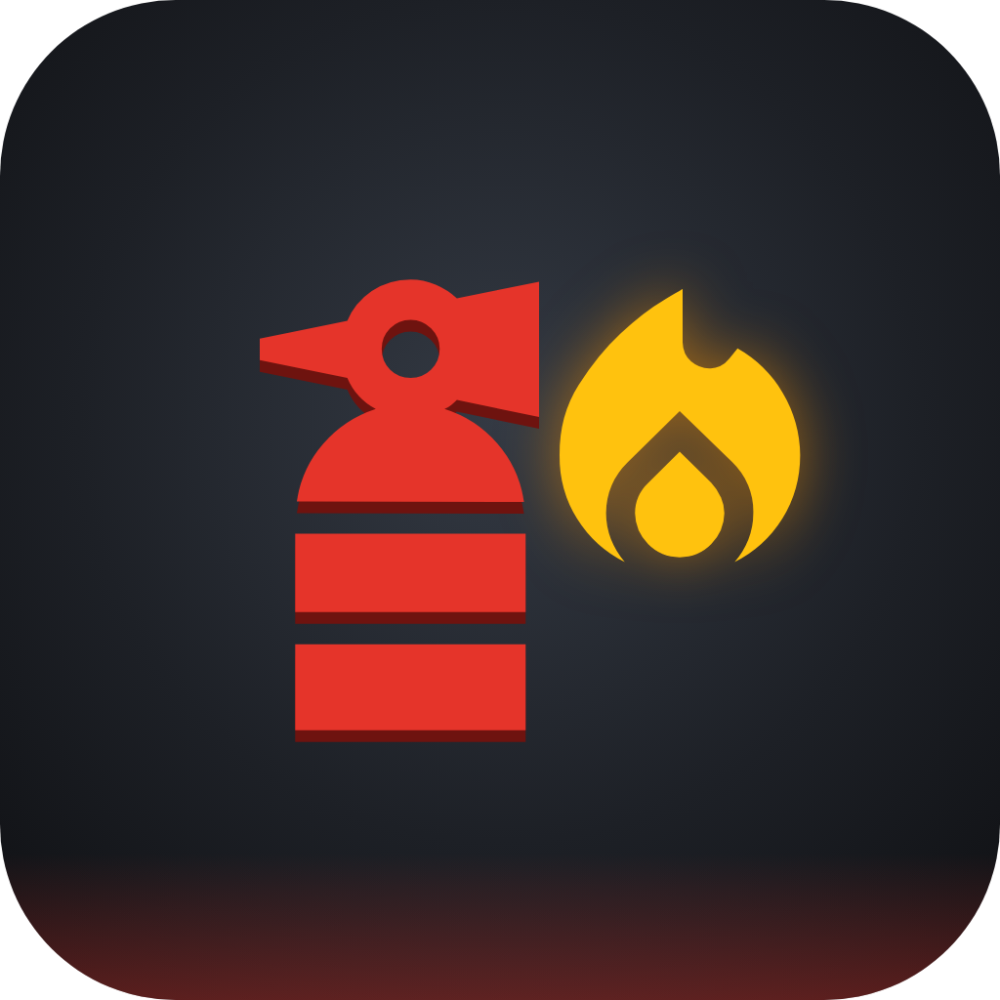

# FireReady AR

An augmented reality fire extinguisher training app for Android. You place a small workshop office on your floor, three fires start one after another, and you have to raise the alarm, pick the right extinguisher for each fire, aim at the base from a safe distance, switch off the power before tackling the electrical fire, and know when to walk away. At the end you get a score out of 100 and a list of every mistake, and the session is saved on the phone.

This is my Assignment 2 for the AR simulation course. It implements the proposal, SRS and design from Assignment 1.

<p align="center"></p>

## Build

| | |
|---|---|
| Platform | Android (ARCore), portrait |
| Minimum Android version | 8.0 (API 26), ARM64 |
| Engine | Unity 6 (6000.4.7f1), Universal Render Pipeline |
| AR | AR Foundation 6.4 with the Google ARCore XR Plugin 6.4 |
| Other packages | Addressables 2.9, Input System, TextMesh Pro, glTFast |

The phone needs to be on [Google's list of ARCore supported devices](https://developers.google.com/ar/devices). On a phone without ARCore the app still installs and shows a message on the start screen instead of crashing.

## Running the project

1. Clone the repo and open the folder with Unity 6000.4.7f1 (Unity Hub will offer to install it).
2. Open `Assets/FireReady/Scenes/Main.unity`.
3. To try it in the Editor, press Play. Without a phone the app falls back to a virtual floor: use WASD to walk and hold the right mouse button to look around. Set the Game view to a portrait size such as 1080 x 2340.
4. To build for Android, open Window > Asset Management > Addressables > Groups and choose Build > New Build > Default Build Script, then File > Build Profiles, pick Android and build.

## How a session works

1. Briefing: four short pages covering the goal, the four extinguishers, the PASS technique and staying safe.
2. AR setup: scan the floor until a 1.5 m x 1.5 m area is found, tap to preview the scene, tap again to move it, then confirm to anchor it.
3. Simulation: fires start at 0, 20 and 40 seconds and grow while nobody sprays them. You tap the alarm call point, pick an extinguisher from the stand, pull the pin, then hold the squeeze button and aim with the phone.
4. Summary: the score, time, aim accuracy, whether the alarm was raised and the power isolated, and each mistake with the time it happened. You can restart in the same placed scene or go back to the menu.

The rules come from the SRS:

| Extinguisher | Paper bin (Class A) | Fuel spill (Class B) | Live extension board |
|---|---|---|---|
| Water (red band) | Puts it out | Makes it spread | Ends the session (shock) |
| Foam (cream band) | Puts it out | Puts it out | Dangerous |
| CO2 (black band) | Weak, can reignite | Puts it out | Puts it out |
| Dry powder (blue band) | Puts it out | Puts it out | Puts it out |

Spraying the base of a fire works at full rate and the flames only get 25 percent. You need to stand between 1 and 2.5 m away. The electrical fire reignites after 8 seconds if the power is still on, and a fire left out of control for 10 seconds ends the session as Failed unless you evacuate through the exit.

## Project layout

```
Assets/FireReady/
  Scripts/
    AR/          ARManager (planes, raycast, placement, anchor, tracking), LightEstimation
    Audio/       AudioManager, pooled one-shot audio sources
    Config/      ScriptableObject definitions for every tunable value
    Content/     AssetManager (Addressables loading and releasing)
    Core/        EventBus, game events, generic ObjectPool, enums
    Data/        Session records, JSON storage, repository, settings
    Effects/     PoolManager, pooled particle effects
    Flow/        SimulationManager and the session state machine
    Simulation/  Fires, extinguishers, agents, entities, scoring and tracking
    UI/          UIManager, screens and widgets
  Tests/EditMode/  NUnit tests for agents, fire rules, scoring, events and saving
  Config/        The ScriptableObject assets (scenario, fires, agents, scoring, theme)
  Prefabs/       Fires, extinguisher, effects and the workshop layout
  ThirdParty/    Downloaded models, textures, effects and sounds, one folder per source
```

## Architecture

The code is split into layers. The flow layer (`SimulationManager` and its state machine) decides what stage the app is in. The simulation layer (`EntityManager`, `InteractionManager`, `TaskManager`, `PerformanceTracker`) runs the fires and the player's actions. The platform layer wraps Unity systems: `ARManager`, `AssetManager`, `DataManager` and `PoolManager`. The presentation layer is the UI and audio.

Calls only go downwards. When something happens lower down, such as a fire going out, the owner publishes an event on the `EventBus`, and the HUD, task list, score and audio react to it without the fire knowing about any of them.

### Design patterns

| Pattern | Where | Why |
|---|---|---|
| State | `Flow/SimulationStateMachine.cs`, `Flow/States/` | Each stage (menu, briefing, AR setup, running, paused, summary) owns its own Enter, Tick and Exit |
| Strategy | `Simulation/Agents/` | Each extinguishing agent decides how it works on each fire class, so the fire and extinguisher code has no agent-specific if statements |
| Factory | `Simulation/Fires/FireFactory.cs` | Creates and configures the right fire subclass from the scenario data, and is reused when burning fuel spreads |
| Observer | `Core/EventBus.cs` | Typed struct events so systems can react to each other without direct references |
| Object pool | `Core/ObjectPool.cs`, `Effects/PoolManager.cs` | Spray puffs, steam, smoke and one-shot sounds are reused instead of created and destroyed every second |
| Singleton | `Flow/SimulationManager.cs` | One object owns the session; it's the only singleton in the project |

### Addressables

| Group | Contents | Loaded | Released |
|---|---|---|---|
| Core | Audio cue table and briefing content | When the app starts | Never |
| Scenario_WorkshopOffice | Layout, fires, extinguishers, scenario config, scoring rules, scenario audio | After the scene is placed | When you go back to the main menu |
| Effects | Pooled spray, steam, splash and smoke effects | With the scenario | With the scenario, after the pools are cleared |

`AssetManager` keeps every handle it opens and releases each one once. Turn on Diagnostics in Settings to see the open handle count go up after placement and back down on returning to the menu.

### Saving

Finished and abandoned sessions are saved to `sessions.json` in `Application.persistentDataPath`. New data is written to a `.tmp` file first and then swapped in, so a crash during a save can't damage earlier sessions. If the file can't be read, it's renamed to `.bak` and the app starts with an empty history. Settings (volume, vibration, diagnostics) are stored in PlayerPrefs. Nothing is sent anywhere, and the Android build has no internet permission.

## Tests

Open Window > General > Test Runner and run the EditMode tests. They cover the agent and fire class table, fire growth and reignition, the score deductions, the event bus and the save file recovery.

## Links

- [Technical documentation (PDF)](https://drive.google.com/file/d/1Q8yXRssK1xJ9aVwF8c_g8eKmqhXd0y9v/view?usp=sharing)
- [Video demonstration (YouTube)](https://www.youtube.com/watch?v=NTgZkTT5YYE)
- [Android build (APK)](https://drive.google.com/drive/folders/1eUoCGpVJiGRD3p4vDVi4SDVhMdfe-F2g?usp=sharing)
- [CREDITS.md](CREDITS.md): every third-party asset with its author, source and license

## Credits

Models, textures, effects, sounds, fonts and icons come from Poly Haven, Sketchfab, ambientCG, Kenney, Freesound, OpenGameArt, Vefects, the Unity Particle Pack, Google Fonts, Material Symbols and Wikimedia Commons. The full list with licenses is in [CREDITS.md](CREDITS.md).

Mutabazi Ishimwe Bruno
